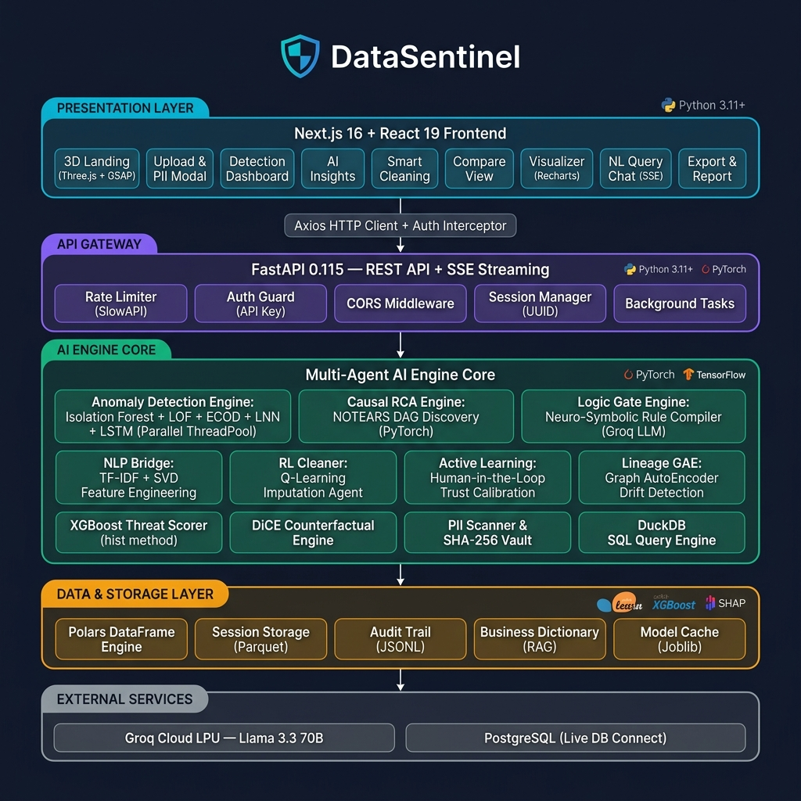
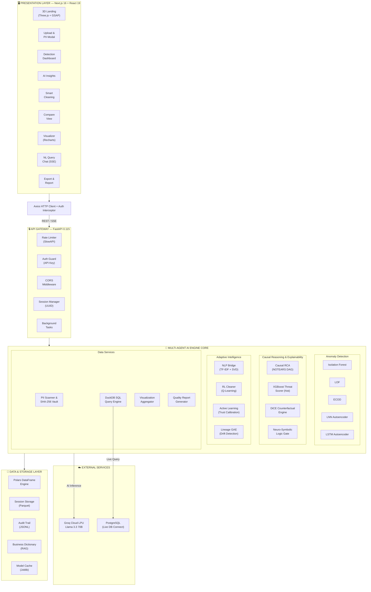
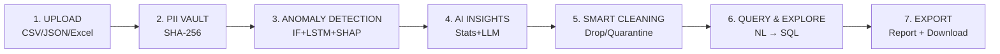

<p align="center">
  
  
  
  
  
  
  
  
</p>

<p align="center">
  
  
  
  
  
</p>

<h1 align="center">🛡️ DataSentinel</h1>

<p align="center">
  <strong>AI-Powered Autonomous Data Quality & Anomaly Detection Platform</strong><br/>
  A multi-agent, neuro-symbolic system that ingests any dataset, detects anomalies, vaults PII,<br/>
  cleans data intelligently, and lets you query it using natural language — all in one cinematic pipeline.
</p>

<p align="center">
  <a href="#-quick-start">Quick Start</a> •
  <a href="#-features">Features</a> •
  <a href="#%EF%B8%8F-system-architecture">Architecture</a> •
  <a href="#-data-pipeline-flow">Pipeline</a> •
  <a href="#-project-structure">Structure</a> •
  <a href="#-api-reference">API Reference</a> •
  <a href="#-tech-stack">Tech Stack</a> •
  <a href="#-security-model">Security</a> •
  <a href="#-environment-variables">Environment</a>
</p>

---

## 🎯 Portfolio Highlights

> **For recruiters & hiring managers** — here's what this project demonstrates at a glance.

| Skill Area | What's Demonstrated |
|---|---|
| 🤖 **Multi-Agent AI Design** | 5 anomaly detection models running in parallel via `ThreadPoolExecutor` with ensemble voting |
| 🧠 **LLM Integration** | Groq (Llama 3.3 70B) used for SQL generation, neuro-symbolic rule synthesis, and narrative insights |
| 📐 **ML Engineering** | SHAP explainability, XGBoost threat scoring, DiCE counterfactuals, NOTEARS causal DAG |
| 🔁 **Reinforcement Learning** | Q-Learning agent (`rl_cleaner.py`) selects optimal imputation strategies per anomaly context |
| 📡 **Full-Stack Engineering** | FastAPI async backend + Next.js 16 App Router + React 19 — production-grade, zero `any` TypeScript |
| 🗄️ **Data Engineering** | Polars DataFrames, DuckDB in-process SQL, Parquet session storage, streaming `io.BytesIO` exports |
| 🔒 **Security & Compliance** | PII scanning, SHA-256 pseudonymisation, SOC2-ready immutable audit trail, rate limiting |
| 🎬 **UI/UX Engineering** | Three.js particle scenes, GSAP scroll animations, Lenis smooth scroll, Framer Motion transitions |

---

## 📖 About DataSentinel

DataSentinel is an advanced, AI-driven data quality and anomaly detection platform designed for data scientists, engineers, and analysts. It streamlines the often tedious process of data cleaning and validation by providing an autonomous, multi-agent pipeline. Users can upload raw datasets and immediately benefit from powerful statistical models (like Isolation Forest and LSTM) working in tandem with natural language processing and neuro-symbolic logic. Beyond just finding errors, DataSentinel explains *why* anomalies occurred using causal reasoning (NOTEARS DAG) and offers smart, automated remediation strategies via Reinforcement Learning. With built-in PII vaulting and natural language querying powered by Groq and DuckDB, it acts as your intelligent, secure co-pilot for end-to-step data preparation.

---

## ✨ Features

| Category | Feature | Description |
|----------|---------|-------------|
| 🔍 **Godmode Detection** | IF + SHAP + LSTM | Statistical anomaly detection coupled with sequential pattern learning, per-row explainability, and threat scoring |
| 🛡️ **Drift & Counterfactuals**| KS-Test & DiCE | Real-time dataset drift detection and counterfactual recommendations on how to remediate anomalies |
| 🧠 **Neuro-Symbolic AI** | Logic Gate Engine | Groq LLM generates domain-specific mathematical validation rules compiled into Polars expressions |
| 🛡️ **Privacy** | PII Scanner & Vault | Local-edge regex + heuristic PII detection with GDPR-compliant SHA-256 pseudonymisation |
| ⚡ **LLM Acceleration** | Groq LPU (Llama 3.3) | Millisecond-latency AI inference for SQL generation, narrative insights, and rule synthesis |
| 💬 **Natural Language Query** | Agentic RAG Chat | Ask questions in plain English — the agent generates SQL, executes it via DuckDB, and self-heals |
| 🧹 **Smart Cleaning** | Multi-Strategy Engine | Drop, quarantine, winsorize, mask, or KNN-impute anomalies with before/after dataset comparison |
| 📊 **Visual Analytics** | Interactive Dashboards| Correlation heatmaps, distribution histograms, scatter plots, and categorical breakdowns powered by Recharts |
| 📋 **Quality Reports** | Exportable Scorecards| AI-generated data quality reports with health scores, missing data maps, and column profiling |
| 🔌 **Live DB Connect** | PostgreSQL Bridge | Connect to production databases for real-time querying without data movement |
| 🚀 **High Throughput** | In-Memory Streaming | Optimized streaming responses (`io.BytesIO`) for heavy dataset exports to prevent I/O bottlenecks |
| 🔒 **Audit Trail** | SOC2-Ready Logging | Immutable JSONL audit trail of every AI-driven data mutation for compliance |
| 🎬 **Cinematic UI** | Premium Experience | GSAP scroll-driven animations, Three.js particle simulations, Lenis smooth scrolling |

---

## 🆚 Why DataSentinel?

Most data quality tools stop at rule checking or basic profiling. DataSentinel is an **end-to-end autonomous pipeline** with capabilities that go significantly further:

| Feature | DataSentinel | Great Expectations | Pandas Profiling | AWS Glue DataBrew |
|---|:---:|:---:|:---:|:---:|
| LLM-Generated Validation Rules | ✅ | ❌ | ❌ | ❌ |
| Causal Root Cause (NOTEARS DAG) | ✅ | ❌ | ❌ | ❌ |
| RL-Based Smart Cleaning Agent | ✅ | ❌ | ❌ | ❌ |
| Natural Language → SQL Chat | ✅ | ❌ | ❌ | ⚠️ Limited |
| SHAP Per-Row Explainability | ✅ | ❌ | ❌ | ❌ |
| DiCE Counterfactual Recommendations | ✅ | ❌ | ❌ | ❌ |
| Active Learning Trust Calibration | ✅ | ❌ | ❌ | ❌ |
| PII Vaulting (GDPR-ready) | ✅ | ❌ | ❌ | ⚠️ Partial |
| Drift Detection (Graph AutoEncoder) | ✅ | ⚠️ Partial | ❌ | ❌ |
| Immutable SOC2 Audit Trail | ✅ | ⚠️ Partial | ❌ | ✅ |
| Local / Self-Hosted | ✅ | ✅ | ✅ | ❌ (Cloud-only) |
| Open Source | ✅ | ✅ | ✅ | ❌ |

---

## 🚀 Quick Start

### Prerequisites

| Tool | Version | Purpose |
|------|---------|---------|
| **Python** | 3.11+ | Backend runtime |
| **Node.js** | 18+ | Frontend runtime |
| **npm** | 9+ | Package management |
| **Groq API Key** | — | LLM inference ([Get one free →](https://console.groq.com)) |

### 1. Clone the Repository

```bash
git clone https://github.com/NishigandhaSawant/DataSentinel-2026.git
cd DataSentinel-2026
```

### 2. Backend Setup

```bash
cd backend

# Create and activate a virtual environment
python -m venv venv

# Windows
venv\Scripts\activate

# macOS / Linux
source venv/bin/activate

# Install all dependencies
pip install -r requirements.txt
```

### 3. Configure Environment Variables

Create a `.env` file inside the `backend/` directory:

```env
# ━━━ REQUIRED ━━━━━━━━━━━━━━━━━━━━━━━━━━━━━━━━━━━━━
GROQ_API_KEY=gsk_your_key_here

# ━━━ OPTIONAL ━━━━━━━━━━━━━━━━━━━━━━━━━━━━━━━━━━━━━
# Protect API endpoints with a key (enables auth guard)
# DS_API_KEY=your_secure_api_key

# Custom salt for PII pseudonymisation (defaults to built-in)
# DS_PII_SALT=your_custom_salt

# CORS whitelist (defaults to localhost:3000)
# CORS_ORIGINS=http://localhost:3000,http://127.0.0.1:3000
```

### 4. Start the Backend

```bash
uvicorn main:app --reload
```

The API server starts at **http://localhost:8000**:

| URL | Description |
|-----|-------------|
| `http://localhost:8000/` | Health check — `{"status": "DataSentinel detection engine is online."}` |
| `http://localhost:8000/docs` | Interactive Swagger API documentation |
| `http://localhost:8000/redoc` | ReDoc API documentation |

### 5. Frontend Setup

Open a **new terminal**:

```bash
cd frontend

# Install dependencies
npm install
```

### 6. Start the Frontend

```bash
npm run dev
```

The application opens at **http://localhost:3000**.

---

## 🏗️ System Architecture

<p align="center">
  
</p>

### Architecture Overview

DataSentinel uses a **decoupled, 5-layer architecture** with a multi-agent AI engine core:



> **Key Design Decisions:**
> - The **Detection Engine** runs 5 models in parallel via `ThreadPoolExecutor` for maximum CPU throughput
> - **Causal RCA** uses continuous DAG optimization (NOTEARS) instead of marginal SHAP for true root cause tracing
> - **Active Learning** dynamically adjusts the Human Trust Score based on operator feedback loops
> - All session data is stored as **Parquet** files with **Joblib**-cached models for instant reload

<details>
<summary>🔬 <strong>AI Engine Deep Dive — How Each Model Works (Click to expand)</strong></summary>

<br/>

### Anomaly Detection (5 Parallel Models)

| Model | File | How It Works |
|---|---|---|
| **Isolation Forest** | `detection.py` | Randomly partitions feature space; anomalies require fewer splits to isolate — yielding a low path-length score |
| **LSTM Autoencoder** | `detection.py` | Learns normal sequential patterns from numeric columns; rows with high reconstruction error are flagged as anomalies |
| **ECOD** | `detection.py` | Empirical Cumulative Distribution outlier detection — no distribution assumptions, robust to skewed data |
| **LOF** | `detection.py` | Local Outlier Factor compares each point's local density to its neighbors — catches cluster-edge outliers IF misses |
| **LNN** | `neuro_symbolic.py` | Logical Neural Network that enforces domain-specific constraints (e.g. `age > 0`, `revenue ≥ cost`) as soft logic gates |

All 5 models vote → results are **ensemble-aggregated** → passed to **XGBoost** (hist booster) for a final normalized threat score (0.0 – 1.0).

### Explainability & Causal Reasoning

| Component | File | How It Works |
|---|---|---|
| **SHAP** | `detection.py` | TreeExplainer computes per-row, per-feature attribution values — tells you *which* columns drove a specific anomaly score |
| **NOTEARS DAG** | `causal_rca.py` | Continuous optimization discovers a directed acyclic graph of column relationships — identifies root causes, not just symptoms |
| **DiCE** | `detection.py` | Generates counterfactual examples: "If `age` were 34 instead of 134, this row would be normal" — actionable remediation |

### Adaptive Intelligence

| Component | File | How It Works |
|---|---|---|
| **RL Cleaner** | `rl_cleaner.py` | Tabular Q-Learning agent learns which cleaning action (drop / winsorize / KNN impute / mask) minimizes data quality loss per anomaly type |
| **Active Learning** | `active_learning.py` | Uncertainty sampling selects the most ambiguous anomalies for human review; operator feedback updates a Human Trust Score that re-weights ensemble votes |
| **Lineage GAE** | `lineage_gae.py` | Graph AutoEncoder models column-to-column relationships; drift in the learned graph embeddings signals schema or distribution shift |
| **Neuro-Symbolic** | `logic_gate.py` | Sends dataset schema + sample rows to Groq LLM → LLM returns Python/Polars validation expressions → compiled and executed as hard constraints |

### Agentic Query Engine

| Component | File | How It Works |
|---|---|---|
| **NL → SQL** | `query.py` | User's natural language question + RAG business dictionary context → Groq generates DuckDB-compatible SQL |
| **Self-Healing** | `query.py` | If DuckDB raises an error, the engine sends the error back to Groq for automatic SQL correction (up to 3 retries) |
| **Vector RAG** | `vector_rag.py` | TF-IDF + SVD vectorizes the business dictionary; cosine similarity retrieves relevant domain terms to ground SQL generation |
| **SSE Streaming** | `main.py` | Query results stream token-by-token to the frontend via Server-Sent Events — no waiting for full response |

</details>

---

## 🔄 Data Pipeline Flow

The platform processes data through a **7-stage sequential pipeline**:



| Stage | Engine | What Happens |
|-------|--------|--------------|
| **1. Upload** | `main.py` + `schema.py` | File parsed (CSV/JSON/Excel) → Schema contract validation → Parquet storage |
| **2. PII Vault** | `pii_scanner.py` | Regex + heuristic scan for emails, phones, SSNs → Optional SHA-256 pseudonymisation |
| **3. Detection** | `detection.py` + `logic_gate.py` + `nlp_bridge.py` | NLP feature engineering → Neuro-symbolic rule generation → Isolation Forest → SHAP explainability → Threat scoring |
| **4. AI Insights** | `insights.py` + `groq_client.py` | Statistical profiling (null rates, skewness, correlations) → Groq LLM narrative generation |
| **5. Cleaning** | `cleaning.py` | Drop, quarantine, winsorize, mask, or KNN-impute anomalies → Save cleaned Parquet |
| **6. Query** | `query.py` + DuckDB | Natural language → Groq generates SQL → DuckDB executes → Auto-correction retry loop |
| **7. Export** | `quality.py` + `visualization.py` | Quality report generation → Chart data aggregation → CSV download |

---

## 📁 Project Structure

```
DataSentinel/
├── backend/
│   ├── main.py                  # FastAPI application & all route definitions
│   ├── auth.py                  # API key authentication guard (constant-time comparison)
│   ├── schema.py                # Data contract validation (SchemaEnforcer)
│   ├── utils.py                 # Session management, logging, audit trail utilities
│   ├── groq_client.py           # Centralized Groq LLM client with retry logic
│   ├── Dockerfile               # Container image definition for the backend service
│   ├── test_upload.py           # Quick upload smoke test (standalone script)
│   ├── engines/
│   │   ├── __init__.py          # Re-exports all engine functions
│   │   ├── active_learning.py   # Active Learning & Uncertainty Sampling
│   │   ├── causal_rca.py        # Continuous DAG Discovery (NOTEARS)
│   │   ├── cleaning.py          # Multi-strategy anomaly cleaning (drop/quarantine/impute)
│   │   ├── detection.py         # Isolation Forest + LSTM anomaly detection pipeline
│   │   ├── insights.py          # Statistical profiling + AI narrative generation
│   │   ├── lineage_gae.py       # Graph AutoEncoder for lineage drift detection
│   │   ├── logic_gate.py        # AI-generated neuro-symbolic validation rules
│   │   ├── neuro_symbolic.py    # Logical Neural Network constraints
│   │   ├── nlp_bridge.py        # NLP feature engineering (TF-IDF + SVD) for text columns
│   │   ├── pii_scanner.py       # PII detection & SHA-256 pseudonymisation
│   │   ├── quality.py           # Data quality report & health score generation
│   │   ├── query.py             # Natural language → SQL via Groq + DuckDB execution
│   │   ├── rl_cleaner.py        # Reinforcement Learning agent for data imputation
│   │   ├── vector_rag.py        # TF-IDF + SVD vector store for RAG business dictionary
│   │   └── visualization.py     # Chart data aggregation (histograms, correlations)
│   ├── data/
│   │   ├── fraud_transactions.csv         # Sample: Financial fraud dataset
│   │   ├── patient_vitals.csv             # Sample: Healthcare vitals dataset
│   │   ├── ecommerce_reviews.csv          # Sample: E-commerce product reviews
│   │   ├── Titanic-Dataset.csv            # Sample: Titanic passenger data
│   │   ├── hospital_readmission_dataset.csv # Sample: Hospital readmission records
│   │   ├── gdpr_stress_test.csv           # Sample: GDPR PII stress-test dataset
│   │   ├── fifa21_raw_data.csv            # Sample: FIFA 21 player statistics
│   │   ├── amazon.csv                     # Sample: Amazon product listings
│   │   ├── HRCEMAIL_names.csv             # Sample: HR/email PII detection dataset
│   │   ├── velocity_engine.csv            # Sample: Streaming velocity anomaly dataset
│   │   ├── business_dictionary.json       # Persistent RAG knowledge base (user-taught terms)
│   │   ├── feedback.jsonl                 # Active learning feedback log
│   │   ├── schemas/                       # Data contract schema definitions
│   │   └── vector_kb/                     # Persisted TF-IDF vector index for RAG
│   ├── tests/
│   │   ├── conftest.py          # Pytest fixtures & shared test setup
│   │   ├── test_api.py          # API endpoint integration tests
│   │   ├── test_cleaning.py     # Cleaning engine unit tests
│   │   ├── test_detection.py    # Detection engine unit tests
│   │   ├── test_insights.py     # Insights engine unit tests
│   │   ├── test_query.py        # Query engine unit tests
│   │   └── test_schema.py       # Schema enforcer unit tests
│   ├── requirements.txt         # Python dependencies
│   └── .env                     # Environment variables (not committed)
│
├── frontend/
│   ├── public/
│   │   └── architecture.png     # System architecture diagram
│   ├── src/
│   │   ├── app/
│   │   │   ├── page.tsx         # Main landing page
│   │   │   ├── layout.tsx       # Root layout with SmoothScroller
│   │   │   ├── globals.css      # Global styles & Tailwind configuration
│   │   │   └── [sessionId]/     # Dynamic session routing App Router
│   │   │       ├── SessionProvider.tsx # Client-side state manager
│   │   │       ├── layout.tsx          # Session layout (nav bar)
│   │   │       ├── upload/page.tsx     # File upload & schema validation
│   │   │       ├── detect/page.tsx     # Detection results & RCA dashboard
│   │   │       ├── insights/page.tsx   # Statistical & AI narratives
│   │   │       ├── clean/page.tsx      # Multi-strategy data cleaning
│   │   │       ├── compare/page.tsx    # Before/After data comparison
│   │   │       ├── edit/page.tsx       # Inline data review & edit
│   │   │       ├── visualize/page.tsx  # Analytics charts
│   │   │       ├── query/page.tsx      # Natural language chat (SSE)
│   │   │       └── report/page.tsx     # Health scorecard & export
│   │   ├── components/
│   │   │   ├── ResetConfirmModal.tsx   # Session reset confirmation dialog
│   │   │   ├── SmoothScroller.tsx      # Lenis smooth scroll wrapper
│   │   │   ├── landing/
│   │   │   │   ├── HeroLanding.tsx        # GSAP scroll-driven cinematic intro
│   │   │   │   ├── PurificationCore.tsx   # Three.js data purification particle animation
│   │   │   │   ├── NeuralCore.tsx         # Three.js neural network background
│   │   │   │   └── AmbientAurora.tsx      # CSS ambient aurora backdrop
│   │   │   ├── detection/       # Anomaly detection results with SHAP visualizations
│   │   │   ├── insights/        # AI-generated insights dashboard with profiles
│   │   │   ├── clean/           # Multi-strategy cleaning action panel
│   │   │   ├── compare/         # Before/after dataset diff comparison
│   │   │   ├── review-edit/     # Data review & inline edit interface
│   │   │   ├── visualizer/      # Charts (histograms, heatmaps, scatter plots)
│   │   │   ├── query/           # Natural language query chat interface (SSE)
│   │   │   ├── export-report/   # Quality report export panel
│   │   │   ├── pii-modal/       # PII detection & pseudonymisation modal
│   │   │   └── SmoothScroller.tsx  # Lenis smooth scroll wrapper
│   │   ├── hooks/
│   │   │   ├── use-detection.ts # Anomaly data fetching & feedback state
│   │   │   ├── use-compare.ts   # Before/after comparison data hook
│   │   │   └── use-viz.ts       # Visualization data & tab state hook
│   │   ├── services/
│   │   │   └── api.service.ts   # Axios instance with auth interceptor
│   │   ├── types/
│   │   │   └── api.ts           # Shared TypeScript interfaces (zero `any` types)
│   │   └── constants/
│   │       └── config.ts        # API base URL & key configuration
│   ├── package.json
│   ├── tsconfig.json
│   ├── next.config.ts
│   ├── eslint.config.mjs
│   └── postcss.config.mjs
│
├── .gitignore
└── README.md
```

---

## 📡 API Reference

All endpoints are served at `http://localhost:8000`. Interactive Swagger docs at `/docs`.

### Core Data Pipeline

| Method | Endpoint | Description |
|--------|----------|-------------|
| `GET` | `/` | Health check — returns engine status |
| `GET` | `/api/health` | Verify Groq API connectivity & model availability |
| `POST` | `/api/upload/` | Upload a dataset (CSV, JSON, Excel, Parquet) with schema validation |
| `GET` | `/api/data/{session_id}` | Fetch dataset rows with filtering (`is_cleaned`, `only_anomalies`) |
| `POST` | `/api/clean/{session_id}` | Clean anomalies — actions: `drop`, `quarantine`, `winsorize`, `mask`, `impute` |
| `GET` | `/api/compare/{session_id}` | Compare raw vs cleaned data side-by-side |
| `GET` | `/api/viz/{session_id}` | Get visualization aggregations (histograms, correlations, categorical) |
| `GET` | `/api/insights/{session_id}` | Generate AI insights with statistical profiles & LLM narratives |
| `GET` | `/api/report/{session_id}` | Generate exportable quality report with health score |
| `GET` | `/api/download/{session_id}` | Download cleaned dataset as CSV |

### Agentic Query System

| Method | Endpoint | Description |
|--------|----------|-------------|
| `POST` | `/api/query/{session_id}` | Natural language query — streams results via SSE (modes: `explore` / `edit`) |
| `POST` | `/api/confirm-edit/{session_id}` | Execute a confirmed SQL mutation with audit logging |

### Privacy & Security

| Method | Endpoint | Description |
|--------|----------|-------------|
| `GET` | `/api/pii-scan/{session_id}` | Scan uploaded data for PII (emails, phones, SSNs, addresses) |
| `POST` | `/api/pseudonymise/{session_id}` | SHA-256 pseudonymise selected PII columns |
| `GET` | `/api/quarantine/{session_id}` | View quarantined anomaly rows |
| `POST` | `/api/feedback/` | Submit human feedback on anomaly classifications |

### Knowledge & Administration

| Method | Endpoint | Description |
|--------|----------|-------------|
| `POST` | `/api/knowledge/learn` | Teach the AI a business term with SQL logic & keywords |
| `POST` | `/api/connect-db/{session_id}` | Connect a live PostgreSQL database for real-time querying |
| `GET` | `/api/admin/audit-logs` | Fetch the immutable audit trail of all AI data mutations |

### Sample Datasets

| Method | Endpoint | Description |
|--------|----------|-------------|
| `GET` | `/api/samples` | List available built-in sample datasets |
| `POST` | `/api/load-sample/{filename}` | Load a sample dataset through the full detection pipeline |

---

## 🔧 Tech Stack

### Backend

| Package | Version | Purpose |
|---------|---------|---------|
| **FastAPI** | 0.115 | Async REST API framework with auto-generated docs |
| **Polars** | 1.27 | High-performance DataFrame engine (10-100x faster than Pandas) |
| **scikit-learn** | 1.6 | Isolation Forest anomaly detection algorithm |
| **SHAP** | 0.46 | Model-agnostic explainability (per-row feature attribution) |
| **DuckDB** | 1.2 | In-process analytical SQL engine for natural language queries |
| **Groq SDK** | latest | LLM inference client (Llama 3.3 70B on Groq LPU hardware) |
| **SlowAPI** | 0.1.9 | Rate limiting middleware for API protection |
| **Pandas** | 2.2 | Excel/fallback CSV parsing & compatibility layer |

### Frontend

| Package | Version | Purpose |
|---------|---------|---------|
| **Next.js** | 16 | React framework with App Router & SSR |
| **React** | 19 | UI component library |
| **Three.js** | 0.183 | 3D particle visualization (PurificationCore, NeuralCore) |
| **@react-three/fiber** | 9.6 | React renderer for Three.js scenes |
| **GSAP** | 3.15 | Scroll-driven cinematic animations |
| **Lenis** | 1.3 | Butter-smooth scroll engine |
| **Framer Motion** | 12 | Page transitions & micro-animations |
| **Recharts** | 3.8 | Data visualization charts (bar, scatter, heatmap) |
| **Tailwind CSS** | 4 | Utility-first CSS framework |
| **Axios** | 1.14 | HTTP client with interceptors |

---

## 🔐 Security Model

DataSentinel implements a **defense-in-depth** security architecture:

| Layer | Implementation |
|-------|---------------|
| **API Authentication** | Optional API key guard with constant-time comparison (`DS_API_KEY`) |
| **PII Protection** | Local-edge scanning — PII is detected and vaulted before any data reaches the LLM |
| **Pseudonymisation** | Salted SHA-256 hashing preserves data relationships while protecting identities |
| **Path Traversal Prevention** | UUID-based session isolation — all file paths are validated against session boundaries |
| **SQL Injection Protection** | DuckDB read-only mode for explore queries, whitelist-based mutation validation |
| **File Upload Safety** | File size caps (50MB), extension whitelist, MIME type validation |
| **Rate Limiting** | SlowAPI middleware prevents abuse (configurable per-endpoint limits) |
| **Audit Trail** | Immutable JSONL log of every data mutation for SOC2/compliance readiness |
| **CORS** | Configurable origin whitelist (defaults to `localhost:3000`) |

> **Opt-in Auth Model:** If `DS_API_KEY` is not set, authentication is bypassed for frictionless local development. Set the key in production to enable the auth guard.

---

## 🔑 Environment Variables

### Backend (`backend/.env`)

| Variable | Required | Default | Description |
|----------|----------|---------|-------------|
| `GROQ_API_KEY` | ✅ **Yes** | — | Your Groq Cloud API key ([get one free](https://console.groq.com)) |
| `DS_API_KEY` | No | — | API key to protect endpoints. Enables auth guard when set |
| `DS_PII_SALT` | No | Built-in default | Cryptographic salt for PII SHA-256 hashing |
| `CORS_ORIGINS` | No | `http://localhost:3000` | Comma-separated allowed CORS origins |

### Frontend (`frontend/.env.local`)

| Variable | Required | Default | Description |
|----------|----------|---------|-------------|
| `NEXT_PUBLIC_API_URL` | No | `http://127.0.0.1:8000` | Backend API base URL |
| `NEXT_PUBLIC_API_KEY` | No | — | Must match `DS_API_KEY` if auth is enabled on backend |

---

## 🧪 Running Tests

### Backend

```bash
cd backend
source venv/bin/activate   # or venv\Scripts\activate on Windows
pytest -v
```

### Frontend

```bash
cd frontend

# TypeScript type checking (zero errors expected)
npx tsc --noEmit

# ESLint linting (zero errors expected)
npx eslint src/
```

---

## 🗒️ Usage Guide

1. **Open** the app at `http://localhost:3000`
2. **Scroll** through the cinematic 3D landing page
3. **Upload** your CSV, JSON, or Excel file — or try a built-in sample dataset
4. **PII Vault** — If personal data is detected, choose columns to pseudonymise before proceeding
5. **Review** detected anomalies with AI-generated explanations, SHAP attributions, and threat scores
6. **Explore** AI-generated insights — statistical profiles, null maps, correlations, and narrative summaries
7. **Clean** the dataset by choosing a strategy: drop, quarantine, winsorize, mask, or impute
8. **Compare** the raw vs cleaned data side-by-side to verify cleaning quality
9. **Edit** data using the review panel for manual corrections
10. **Visualize** distributions, correlation heatmaps, and categorical breakdowns
11. **Query** your data using natural language (e.g., *"Show me all transactions above $10,000"*)
12. **Teach** the AI new business terms for better query understanding
13. **Export** a quality report and download the cleaned CSV

---

## 🤝 Contributing

1. Fork the repository
2. Create your feature branch (`git checkout -b feature/amazing-feature`)
3. Commit your changes (`git commit -m 'feat: add amazing feature'`)
4. Push to the branch (`git push origin feature/amazing-feature`)
5. Open a Pull Request


---

## 📜 License

This project is for educational and portfolio purposes.

---

<p align="center">
  Built with ❤️ using <strong>FastAPI</strong>, <strong>Next.js</strong>, <strong>Groq</strong>, and <strong>Three.js</strong>
</p>